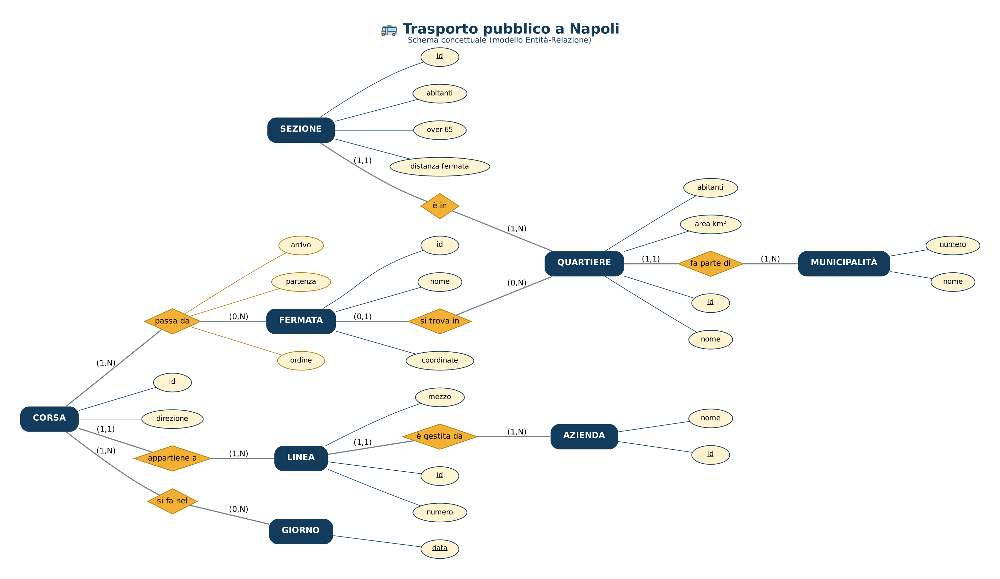
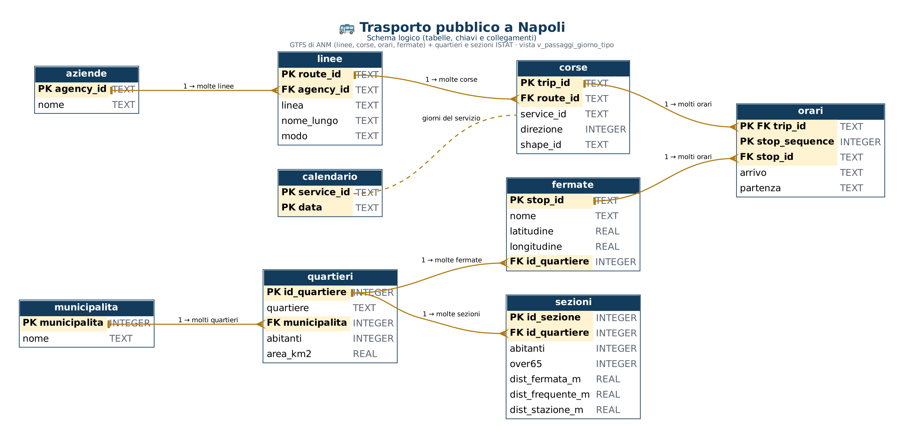

# 🚌 Trasporto pubblico a Napoli: i quartieri sono serviti allo stesso modo?

Progetto di **Francesco Autorino** – Data Analyst.

🛠️ Strumenti: **SQL · Python · Power BI**

📊 Dati: **GTFS di ANM** (107 linee, 6.662 corse nel giorno tipo, 1.839 fermate in città) e **censimento ISTAT 2021** (30 quartieri, 4.219 sezioni abitate, 921.142 abitanti).

📅 Giorno tipo: **mercoledì 18 ottobre 2023**. Distanze in linea d'aria.

---

## 🧭 1. Il progetto in breve

❓ **La domanda**: i quartieri di Napoli sono serviti in modo simile da autobus, metro e funicolari?

Le 5 domande più piccole:

1️⃣ 🚏 Dove ci sono più fermate e più linee?

2️⃣ 🔁 Quante corse passano, e in quali ore?

3️⃣ 🚶 Quanta strada si fa per arrivare alla fermata più vicina?

4️⃣ 🚇 Chi ha vicino una metro o una funicolare?

5️⃣ 🏆 Quali quartieri sono serviti meglio e quali peggio?

---

## 🎯 2. I risultati principali

🚏 **9 napoletani su 10** (92,8%) hanno una fermata a meno di **300 metri**. In media **135 metri**.

🔁 In media passano **155 mezzi al giorno ogni 1.000 abitanti**.
La **Municipalità 1** (San Ferdinando, Chiaia, Posillipo) ne ha **215**, la **Municipalità 7** (Miano, Secondigliano, San Pietro a Patierno) solo **77**.

🕐 Picco tra le **7 e le 10**. Funicolari dalle 7 alle 22, Linea 1 dalle 6 alle 23:35. Di notte solo 66 corse.

🚶 Si cammina di più a **Pianura** (267 m in media, solo il 69% entro 300 m), **Chiaiano** e **San Pietro a Patierno**.
A Pianura quasi **3.000 anziani** abitano a più di 300 m da una fermata.

🚇 Solo il **53%** ha una metro o una funicolare a meno di **800 m** (10 minuti a piedi).
Nessuno a **Pianura, Soccavo, Ponticelli, Secondigliano e San Pietro a Patierno**: oltre **195.000 abitanti**.

🏆 Serviti meglio: **Montecalvario, Mercato, Chiaia, San Ferdinando, Vomero**.
Serviti peggio: **San Pietro a Patierno, Pianura, Chiaiano, Ponticelli, Soccavo**.

⚠️ Nel GTFS di ANM **non ci sono** i treni EAV (Cumana, Circumflegrea, Circumvesuviana): in alcune periferie i treni ci sono, ma non sono contati.

---

## 🛠️ 3. Perché questi strumenti

🗄️ **SQL**: il GTFS è fatto di tabelle collegate (linee → corse → orari → fermate). È perfetto per le query: JOIN, viste, `RANK`, `ROW_NUMBER`, `PERCENT_RANK`.

🐍 **Python**: mappe, fermate dentro i quartieri e distanza dalla fermata più vicina per ogni sezione di censimento (geopandas e scipy).

📊 **Power BI**: si sceglie la **municipalità** e il **mezzo** con i pulsanti; le mappe sono disegnate con i punti.

---

## 🔄 4. Il percorso dei dati

```
Open Data Napoli      ISTAT 2021                          02_pulizia.py                     ANALISI
GTFS di ANM ──────┐   quartieri + sezioni + abitanti ──┐
(linee, fermate,  ├──────────────────────────────────────┴──► ✅ quartieri, fermate, ──┬──► 🗄️ SQL
 orari)           │                                          sezioni, linee, orari     ├──► 🐍 Python
                  └─► 01_scarica.py (1GrezziNonPuliti)                                  └──► 📊 Power BI
```

🧹 **Cosa ho fatto durante la pulizia**

| Passo | Cosa | Risultato |
|---|---|---|
| 1 | Letti i confini dei 30 quartieri e delle 10 municipalità (ISTAT 2021) | 921.142 abitanti |
| 2 | Lette le sezioni di censimento di Napoli e gli abitanti per età | 4.219 sezioni abitate |
| 3 | Controllo: abitanti delle sezioni = abitanti dei quartieri | 921.142 = 921.142 ✅ |
| 4 | Letti i file GTFS | 110 linee, 15.726 corse, 2.357 fermate, 399.186 orari |
| 5 | Controllati orari doppi e fermate che non esistono | 0 e 0 |
| 6 | Orari dopo mezzanotte scritti come 24:xx o 25:xx: convertiti in ore del giorno | 6.127 |
| 7 | Scelto il giorno tipo: mercoledì 18/10/2023 (feriale, senza feste) | 6.662 corse, 107 linee |
| 8 | Ogni fermata messa nel suo quartiere; tolte quelle fuori Napoli | −495 |
| 9 | Tolte le fermate senza corse nel giorno tipo | −23 |
| 10 | Distanza dalla fermata più vicina per ogni sezione (coordinate UTM 33N, in metri) | 4.219 distanze |
| 11 | Indicatori per quartiere, municipalità e linea | 30 quartieri |

🧮 **Le misure usate**

| Misura | Cosa vuol dire |
|---|---|
| Passaggio | un mezzo che si ferma a una fermata (una corsa con 30 fermate = 30 passaggi) |
| Distanza media | distanza dalla fermata più vicina, media pesata sugli abitanti |
| Entro 300 m | % di abitanti con una fermata a meno di 300 m (circa 4 minuti a piedi) |
| Fermata frequente | fermata con almeno 8 passaggi tra le 7 e le 9 (uno ogni 15 minuti) |
| Stazione | fermata di metro (Linea 1, Linea 2) o funicolare (4 linee) |
| **Punteggio** (0-100) | media di 3 classifiche: fermata a 300 m, fermata frequente a 500 m, stazione a 800 m |

---

## 📁 5. I file in questo repository

| File | A cosa serve |
|---|---|
| `README.md` | Questo file |
| `DESCRIZIONE_GITHUB.md` | Nome, descrizione e topics del repository |
| `00_LEGGIMI.md` (in ogni cartella) | Una spiegazione corta di quella cartella |

### 📂 01SQL

| File | A cosa serve |
|---|---|
| `01_schema_concettuale.png` | 🧩 Lo schema concettuale (modello Entità-Relazione) |
| `02_schema_logico.png` | 🗂️ Lo schema logico: tabelle, chiavi PK/FK e collegamenti |
| `03_crea_database.sql` | 🏗️ Crea le 9 tabelle (GTFS + quartieri e sezioni) e la vista `v_passaggi_giorno_tipo` |
| `04_query_analisi.sql` | 🔍 **18 query** divise per domanda: JOIN, viste, RANK, ROW_NUMBER, PERCENT_RANK, medie pesate |

🧩 **Schema concettuale**



🗂️ **Schema logico**



### 📂 02Python

| File | A cosa serve |
|---|---|
| `01_analisi_trasporti_napoli.ipynb` | 📓 L'analisi completa con 9 grafici e mappe (si legge anche su GitHub) |
| `02_CONCLUSIONI.md` | ✅ Le risposte alle 5 domande |

### 📂 03PowerBi

| File | A cosa serve |
|---|---|
| `01_TrasportiNapoliDashboard.zip` | ⭐ **La dashboard**: estrai lo zip e apri `TrasportiNapoli_Dashboard.pbip` con Power BI Desktop |
| `02_TrasportiNapoli_Dashboard.pdf` | 📄 La dashboard in PDF |
| `03_misure_DAX.txt` | 🧮 Le 22 misure DAX |

📊 **Le 7 pagine della dashboard**

1. **Panoramica**: 6 numeri chiave, la mappa delle fermate (bus, metro, funicolari), il punteggio dei quartieri
2. **Fermate e linee**: fermate ogni 10.000 abitanti, tutte le linee con orari, fermate per municipalità
3. **Corse e orari**: corse ora per ora, passaggi ogni 1.000 abitanti per quartiere e municipalità
4. **A piedi**: la mappa delle case colorata per distanza dalla fermata, % entro 300 m
5. **Metro e funicolari**: chi ha una stazione a 10 minuti a piedi
6. **La classifica**: tutti i 30 quartieri con tutte le misure
7. **Conclusioni**

🎛️ In alto si sceglie la **municipalità** (M1-M10), in basso il **mezzo** (bus, metro, funicolare).

---

## 📦 6. Dati e script

📌 Qui ci sono solo i **risultati**: schemi, query, analisi e dashboard.

📥 I dati si possono riscaricare dalle fonti (link più sotto).

🐍 Gli script Python di raccolta e pulizia dei dati e il database sono disponibili su richiesta.

---

## ⚠️ 7. Limiti

📌 Orari **programmati** dell'autunno 2023: non conosciamo ritardi, corse saltate o mezzi pieni.

📌 Il file pubblicato nel 2025 contiene ancora gli orari del 2023.

📌 Distanze **in linea d'aria**: a piedi, con salite e scale, la strada è più lunga.

📌 Mancano i treni **EAV** (Cumana, Circumflegrea, Circumvesuviana) e i bus regionali.

📌 Abitanti del censimento **2021**.

📌 Il punteggio dipende dalle 3 misure scelte: serve per confrontare, non è un voto ufficiale.

---

## 🔗 8. Da dove arrivano i dati (link)

| Fonte | Cosa ho preso | Link |
|---|---|---|
| Open Data Comune di Napoli – Azienda Napoletana Mobilità | Il GTFS di ANM: linee, fermate e orari programmati (`google_transit.zip`) | https://dati.comune.napoli.it/dataset/azienda-napoletana-mobilita |
| ISTAT – Basi territoriali e variabili censuarie | La pagina con tutti i file usati qui sotto | https://www.istat.it/notizia/basi-territoriali-e-variabili-censuarie/ |
| ISTAT – Aree sub-comunali 2021 | Confini e abitanti dei 30 quartieri e delle 10 municipalità (`ASC_21.zip`) | https://www.istat.it/wp-content/uploads/2025/04/ASC_21.zip |
| ISTAT – Basi territoriali 2021, Campania | Mappe delle sezioni di censimento (`R15_21.zip`) | https://www.istat.it/storage/cartografia/basi_territoriali/2021/R15_21.zip |
| ISTAT – Censimento 2021 per sezione | Abitanti per età in ogni sezione (dal file di tutte le regioni, solo Campania) | https://esploradati.istat.it/databrowser/DWL/PERMPOP/SUBCOM/Dati_regionali_2021.zip |
| GTFS (Google) | Come è fatto un file GTFS | https://gtfs.org/documentation/schedule/reference/ |

📅 Dati scaricati il **27 ottobre 2026**.

---

## 🪜 9. Tutti i passaggi fatti, in ordine

1️⃣ **Scelta del progetto**: il trasporto pubblico nella mia zona, con dati ufficiali del Comune e dell'ISTAT.

2️⃣ **Domande**: ho fissato le 5 domande e il giorno tipo.

3️⃣ **Raccolta** (`01_scarica.py`): GTFS di ANM, confini dei quartieri, sezioni di censimento e abitanti.

4️⃣ **Controllo**: orari doppi, fermate inesistenti, orari dopo mezzanotte, fermate fuori città o senza corse.

5️⃣ **Pulizia e calcoli** (`02_pulizia.py`): fermate nei quartieri, distanza dalla fermata più vicina per ogni sezione, indicatori.

6️⃣ **SQL**: schema concettuale e logico, database SQLite con 9 tabelle e una vista, 18 query provate.

7️⃣ **Python**: notebook con 9 grafici e mappe, e le conclusioni.

8️⃣ **Power BI**: dashboard di 7 pagine con mappe a punti e pulsanti per municipalità e mezzo, aperta e controllata in Power BI Desktop.

9️⃣ **PDF**: esportata la dashboard in `TrasportiNapoli_Dashboard.pdf`.

🔟 **Conclusioni**: risposte alle 5 domande e limiti.
